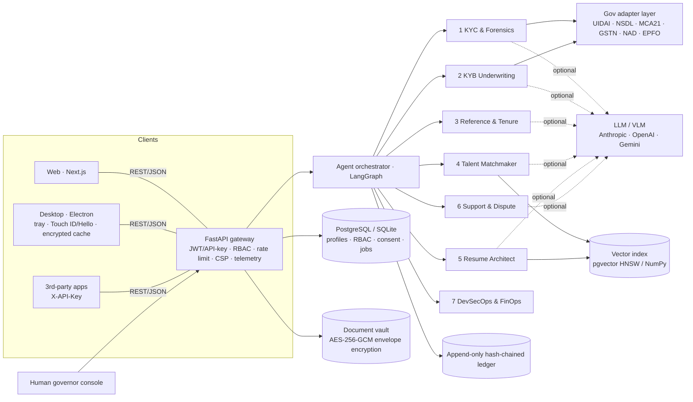

# VerifyHire — Architecture

## System view



## Document pipeline (orchestrator graph)

```
upload / ZIP / folder ──► KYC & Forensics graph
                           decrypt → extract (pypdf · python-docx · Tesseract OCR)
                           → classify → parse fields → VLM review (optional)
                           → forensics → gov verify → decide → apply (mask, badge, profile update)
                         ├─ rejected ──► stop (candidate notified)
                         └─ verified / flagged ──► Resume Architect (Trust Score, gaps, re-embed)
                                                   ──► Matchmaker (re-rank every open job, notify)
```

Flagged decisions with risk ≥ 35 set `needs_human` and appear in the governor queue. Everything else is
closed autonomously.

## Security & privacy design

| Requirement (RFP §4) | Implementation |
|---|---|
| Zero raw Aadhaar storage | Only `XXXX-XXXX-1234` + HMAC token. Aadhaar number never in DB/extracted fields; first 8 digits blacked out on stored card images (OCR-located). Duplicate-Aadhaar across accounts blocked via token. |
| Envelope encryption, CMEK-ready | Per-file 256-bit DEK, AES-256-GCM, owner-id bound as AAD. DEKs wrapped by versioned KEKs (`VAULT_KEKS`). Rotation re-wraps DEKs only. Full PAN sealed the same way at field level. |
| Consent & access control (DPDP) | Employer requests named document types → candidate grants with time limit (slide + OS biometric / WebAuthn), denies or revokes. Expiry enforced on every access and by the DevSecOps patrol. Aadhaar images are never shareable. |
| Dynamic watermarking | Each employer view is server-stamped with company, viewer email, UTC time and the audit sequence number (PDF and images). `no-store` caching. |
| Hold-to-reveal | Masked contact/PAN/CTC, unmasked server-side for 10 s only with an active grant (PAN also needs `reveal_identity_numbers`). Each reveal is a ledger event visible to the candidate. |
| Immutable audit | `audit_events` rows commit to the previous hash; `/admin/ledger/verify` re-walks the chain. A unit test proves tampering is detected. |
| RBAC | candidate · employer_admin · recruiter (corporate domain enforced) · admin. Unverified (non-KYB-approved) employers cannot search or view candidates. |
| Anti-scraping / abuse | Per-IP rate limits; >N distinct profile views/min blocks the recruiter account and logs a security block. |
| Headers | CSP, X-Frame-Options DENY, nosniff, Referrer-Policy, Permissions-Policy. |

## RFP coverage (Phase 1 & 2 scope)

| RFP item | Status | Where |
|---|---|---|
| M01 Aadhaar OTP e-KYC, PAN validation, name/DOB/father cross-match | ✅ sandbox adapters | `api/candidate.py`, `services/gov.py`, `agents/kyc_forensics.py` |
| M01 Selfie liveness | ✅ face presence + inter-frame motion (OpenCV) · face-match vs ID photo: Phase 3 | `kyc_forensics.liveness_check` |
| M01 Dossier OCR (resume, degree/NAD, experience letters, payslip CTC) | ✅ | `agents/kyc_forensics.py` |
| M01 Verified reference network | ✅ signed links, ring detection | `agents/reference_tenure.py` |
| M01 Granular, time-bound consent | ✅ | `AccessGrant`, consent endpoints |
| M02 Corporate PAN, CIN, GSTIN, revenue, EPFO headcount | ✅ | `agents/kyb_underwriting.py` |
| M02 Recruiter sub-accounts tied to corporate domain | ✅ | `/employer/recruiters` |
| M03 Candidate dashboard: Trust Score, audit log, consent, CTC benchmark, job alerts | ✅ | `frontend/app/candidate` |
| M03 Employer dashboard: pipeline, match feed, watermarked viewer, interview scheduler, analytics | ✅ | `frontend/app/employer` |
| M04 Prompt-to-JD, NL hybrid search, explainable scoring | ✅ | `agents/talent_matchmaker.py` |
| M05 Desktop (tray, encrypted cache, batch ingest, biometric) | ✅ Electron | `desktop/` |
| M05 Mobile apps | Phase 3 (web client is responsive with touch gestures today) | — |
| §5 Slide-to-consent, swipe-to-shortlist (right/left/up), drag-drop ingest, hold-to-reveal | ✅ | `components/ui.tsx` |
| §5 Auto-snap capture with glare/moiré check | Phase 3 (mobile) | — |
| §6 Seven agents | ✅ all seven | `backend/app/agents/` |
| §4 GraphQL, mTLS, passkey login | Phase 3 (REST + OpenAPI + API keys today) | — |
| §7 Automated tests (unit + end-to-end) | ✅ | `backend/tests`, CI workflow |

## Scaling path

* **Vector search:** `VectorIndex` uses pgvector HNSW automatically when `DATABASE_URL` is PostgreSQL with
  the extension. Hybrid search pre-filters in SQL, then ranks by vector similarity. Measured latency on
  the demo set is about 10 ms end to end. For 10M+ profiles: pgvector partitions or Qdrant behind the
  same interface.
* **Stateless API:** run N instances. Move the in-process patrol loop to a scheduled worker and the
  telemetry counters to Redis.
* **Storage:** swap `core/vault.py` put/get for S3/GCS with CMEK. The interface is unchanged.

> Note: the pgvector branch and the Docker image were written for production but could not be
> exercised in the build sandbox, which had no Postgres or Docker registry access. The SQLite/NumPy
> path is covered by the test suite.
